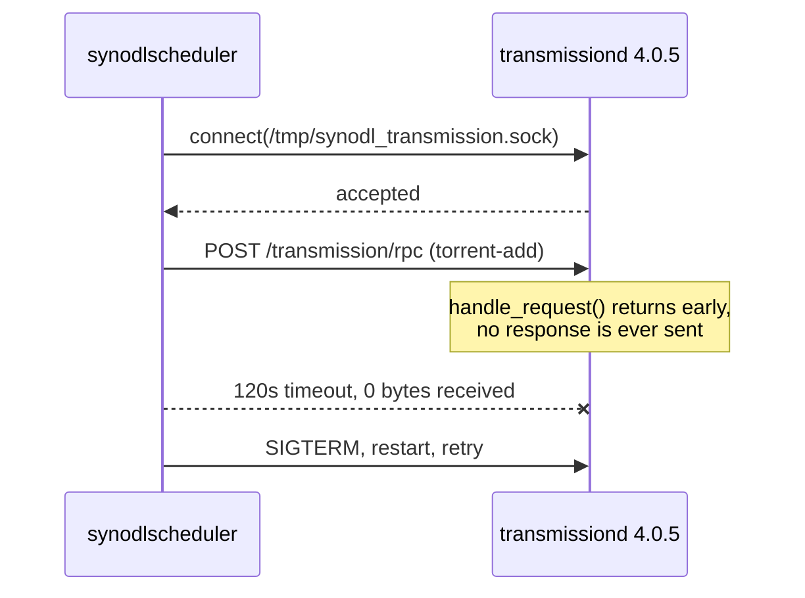

# synology-downloadstation-bt-fix

Restores BitTorrent downloads in Synology DownloadStation by replacing the bundled `transmissiond` with a newer Transmission that answers RPC, runs with the right socket group, and honors the private `task-id` argument DownloadStation depends on.

HTTP and FTP downloads are unaffected by the bug and keep working either way. Only BitTorrent is broken, and it is broken completely: no torrent can ever be added.

Three separate defects have to be fixed together. Each one alone still leaves BitTorrent dead, which is likely why this has gone unfixed for so long.

## Symptoms

Every BitTorrent task fails the same way, regardless of the torrent, the tracker, or the destination folder.

- A torrent is added and immediately sits in an error state, or disappears.
- Tasks show bytes received but never complete a single piece, and no data file is written.
- Deleting a stuck task can hang the DownloadStation UI for two minutes.
- `/volume1/@appdata/DownloadStation/log/downloadstation.log` repeats this triplet:

```
transmission_rpc.cpp:220 SendTransmissionRPC error, status_code=0,
  error=Operation timed out after 120000 milliseconds with 0 bytes received
transmissiond.cpp:237 Failed to add torrent [/volume1/@download/<id>/<id>.torrent]
scheduler.cpp:1292 Failed to add torrent, task id: <id>
```

Reinstalling DownloadStation does not help. Resetting settings does not help. The network, the trackers, and the firewall are not involved.

## Root cause

DownloadStation does not implement BitTorrent itself. It bundles `transmission-daemon` and drives it over a Unix domain socket at `/tmp/synodl_transmission.sock`. The scheduler sends an RPC request to add the torrent and waits.

The bundled daemon accepts the connection and never replies. After 120 seconds DownloadStation gives up, kills the daemon, restarts it, and retries forever.



In `libtransmission/rpc-server.cc`, the whole request handler is wrapped in a guard:

```cpp
void handle_request(struct evhttp_request* req, void* arg)
{
    auto* server = static_cast<tr_rpc_server*>(arg);

    if (req != nullptr && req->evcon != nullptr)
    {
        ...
    }
}
```

When that condition is false the function returns without sending anything: the connection is accepted, the request is read, and no reply is ever written. Every other branch inside the handler sends a response, so this is the only path that can produce silence.

Transmission 4.1.0 removed the guard and replaced the peer lookup with `evhttp_connection_get_peer()`. That change is what this project ships.

### Why downgrading cannot work

Two facts, both verifiable against the upstream git history:

| Version | Unix-socket RPC | Guard present |
|---|---|---|
| 3.00 | not implemented | n/a |
| 4.0.0 through 4.0.6 | implemented | yes, `rpc-server.cc:427` in 4.0.0 |
| 4.1.0 and later | implemented | removed |

Transmission gained Unix-socket RPC in the 4.0 series. Anything older cannot bind `unix:/tmp/synodl_transmission.sock` at all, so it cannot serve DownloadStation regardless of the bug. And every 4.0.x release carries the guard. There is no older build to fall back to; the only direction that works is forward.

### The second defect: socket group ownership

Upstream Transmission only `chmod`s the RPC socket; it never sets the group. Synology's build ends up with `root:DownloadStation`, but a stock upstream build produces `root:root`. Combined with the configured `rpc-socket-mode` of `0770`, that makes the socket unopenable by the `DownloadStation` user that `synodlscheduler` runs as, which fails instantly with `status_code=0` and an empty error string.

Setting the setgid bit on the installed binary gives the daemon an effective group of `DownloadStation`, so the socket it creates inherits that group and matches stock exactly. The installer does this.

### The third defect: DownloadStation's private `task-id` extension

This one is why a stock upstream binary alone is not enough. A wire capture of the real exchange shows what DownloadStation actually does:

```json
{"method":"torrent-add","arguments":{"filename":"/volume1/@download/293/293.torrent","download-dir":"...","paused":false,"task-id":293}}
{"method":"torrent-get","arguments":{"ids":[293],"fields":["id","status","sizeWhenDone","name","isFinished"]}}
```

DownloadStation passes its own task number into `torrent-add` as a non-standard `task-id` argument, and then looks the torrent up **by that number**. Synology patched Transmission so the torrent's internal id becomes the supplied `task-id`. Stock Transmission ignores the unknown argument and assigns a sequential id, so the follow-up query asks for id 293, gets `{"torrents":[]}`, and DownloadStation reports `Failed to get torrent info`.

[patches/0001-honor-downloadstation-task-id.patch](patches/0001-honor-downloadstation-task-id.patch) restores that behaviour in 45 lines. `tr_torrents::add()` already stores torrents in a lookup table that tolerates gaps, so honoring an arbitrary id only requires growing the table and placing the torrent at the requested index, falling back to the sequential id when the slot is taken or no id was supplied.

### Why the newer daemon still talks to DownloadStation

Transmission 4.1 introduced a JSON-RPC 2.0 API, which raises the obvious question of whether an older client still works. It does. The release ships `libtransmission/api-compat.cc`, a compatibility layer mapping 212 legacy mixed-case RPC keys onto the current snake-case names. Older clients are a supported case upstream, not an accident, which is why DownloadStation needs no modification of its own.

### Why not patch DownloadStation instead

The RPC client lives in `libsynodl-transmission-rpc.so` and `libsynodldomainsocket.so`, both stripped closed-source binaries. Patching them would break on every package update and could not be published as reviewable source. Replacing the GPL daemon is the smaller, honest change.

## Compatibility

| Item | Value |
|---|---|
| Verified on | DS923+ (platform `r1000`), DSM 7.3.2-86009 Update 4, DownloadStation 4.1.2-5012 |
| Bundled daemon | transmission-daemon 4.0.5 (82ea3bbe46) |
| Replacement | transmission-daemon 4.1.1 plus the `task-id` patch |
| Result | Ubuntu 24.04.4 ISO at 7.5 MB/s, 200 peers, correct size and progress in the UI |
| Architectures | `x86_64`, `aarch64` |
| DSM runtime | glibc 2.36, libstdc++ 6.0.31, libcurl.so.4, libssl.so.3, libevent-2.1.so.6 |

The binary is built on Debian 12, which ships glibc 2.36 and GCC 12, matching DSM exactly. `libstdc++` and `libgcc` are linked statically so the C++ ABI cannot drift.

Distribution sonames do not line up with DSM, so the build links Transmission's bundled copies of libevent, libdeflate, libpsl, libb64, dht, libutp, libnatpmp and miniupnpc rather than the system ones. Debian 12 ships `libevent-2.1.so.7` while DSM has `libevent-2.1.so.6`; a binary linked against the system libraries fails at startup with `error while loading shared libraries`. After bundling, the only shared objects the daemon needs are ones DSM already provides:

| Library | Present on DSM |
|---|---|
| `libcurl.so.4` | yes |
| `libssl.so.3` | yes |
| `libcrypto.so.3` | yes |
| `libm.so.6`, `libc.so.6`, `ld-linux-x86-64.so.2` | yes |

Note that `/tmp` is mounted `noexec` on DSM, so a binary staged there cannot be executed. The installer stages into the package directory instead and validates it there, which sidesteps the problem; keep it in mind if you test a binary by hand.

[REFERENCE.md](REFERENCE.md) carries the full inventory: exact versions, every path touched, expected ownership and modes, SHA-256 checksums, and the DSM utilities the scripts depend on.

Other models are likely affected by the same bug, but only the hardware listed above has been tested. Check your own daemon before assuming:

```sh
/var/packages/DownloadStation/target/sbin/transmissiond --version
```

## Install

Download the artifact for your architecture from the releases page, or build it yourself with [build/build.sh](build/build.sh).

```sh
sudo ./scripts/install.sh ./dist/transmissiond-4.1.1-taskid-x86_64
```

The installer stops DownloadStation, backs up the stock binary to `transmissiond.stock`, installs the replacement with the original owner and mode, restarts the package, and then proves the fix by sending a real RPC request over the domain socket. It refuses to install anything that is not an ELF binary identifying itself as `transmission-daemon`.

## Verify

```sh
sudo ./scripts/verify.sh
```

Reports the active daemon, both checksums, whether the patch is still applied, and the live RPC probe result. `RESPONSE HTTP/1.1 409 Conflict` is a pass: 409 is Transmission asking for a session id, which proves the handler ran and replied.

## Surviving DownloadStation updates

Updating the DownloadStation package overwrites `transmissiond` and silently reintroduces the bug. The installer keeps a copy of the patched binary, and [scripts/reapply.sh](scripts/reapply.sh) restores it when it detects a mismatch.

Add it as a scheduled task in DSM so it heals itself:

1. Open **Control Panel** and choose **Task Scheduler**.
2. Click **Create**, then **Triggered Task**, then **User-defined script**.
3. Set **Task** to `dsfix reapply`, **User** to `root`, and **Event** to `Boot-up`.
4. Open the **Task Settings** tab and put this in **User-defined script**, adjusting the path to where you cloned the repo:

```sh
/volume1/Arquivos/dsfix/scripts/reapply.sh
```

5. Click **OK** and confirm the warning about running scripts as root.

Repeat with a **Scheduled Task** running daily if you want it checked more often than at boot. The script is idempotent and exits immediately when the patch is already active.

When a package update replaces the daemon, `reapply.sh` promotes the newly installed vendor binary to be the stock backup before restoring the patched one, so `uninstall.sh` always returns you to the vendor binary you currently have rather than an outdated one.

One judgement call the script deliberately leaves to you: if Synology ever ships a DownloadStation release that fixes this properly, `reapply.sh` will keep replacing their fixed daemon with this one. After any DownloadStation update, run `verify.sh` and check the reported stock version. If the stock daemon answers RPC on its own, remove the scheduled task and run `uninstall.sh`; the fix has served its purpose.

## Uninstall

```sh
sudo ./scripts/uninstall.sh
```

Restores the stock daemon from the backup. BitTorrent will stop working again, which is the expected outcome of going back to the unpatched binary.

## Build from source

```sh
TARGET_ARCH=x86_64 BUILD_JOBS=4 ./build/build.sh
```

The build runs in a `debian:12` container and emits a stripped binary plus a `.sha256` file into `dist/`. Set `TARGET_ARCH=aarch64` for ARM models. On a machine with less than 4 GB of RAM available to Docker, keep `BUILD_JOBS=1`; the compiler is memory-hungry and gets OOM-killed otherwise, especially under QEMU emulation.

Building on a host of a different architecture requires `binfmt_misc` emulation. Docker Desktop and Colima provide it by default.

## Licence

Transmission is licensed under the GPL. This repository distributes an unmodified upstream Transmission release built from the official source tarball, so the corresponding source is the published upstream release named in [build/build-in-container.sh](build/build-in-container.sh), fetched at build time from the Transmission project's own release page.

The scripts in this repository are provided under the MIT licence. Nothing here is affiliated with or endorsed by Synology or the Transmission project.

## Disclaimer

This replaces a vendor binary inside a package directory. It is reversible, and the stock binary is preserved, but it is not a supported configuration. Synology support will reasonably decline to help while it is applied. Run [scripts/uninstall.sh](scripts/uninstall.sh) before opening a support case.
