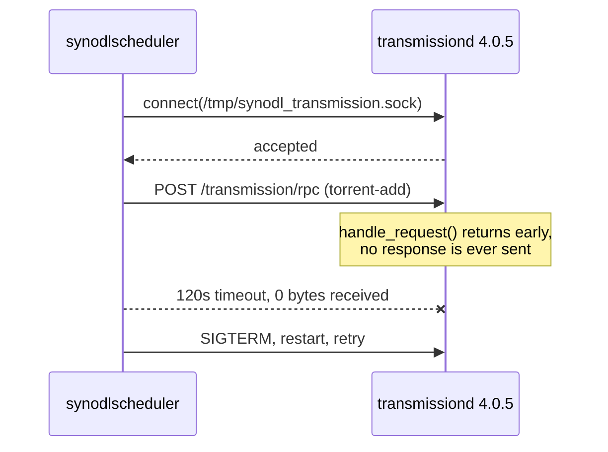
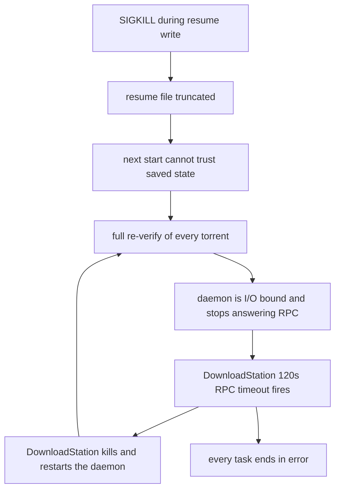
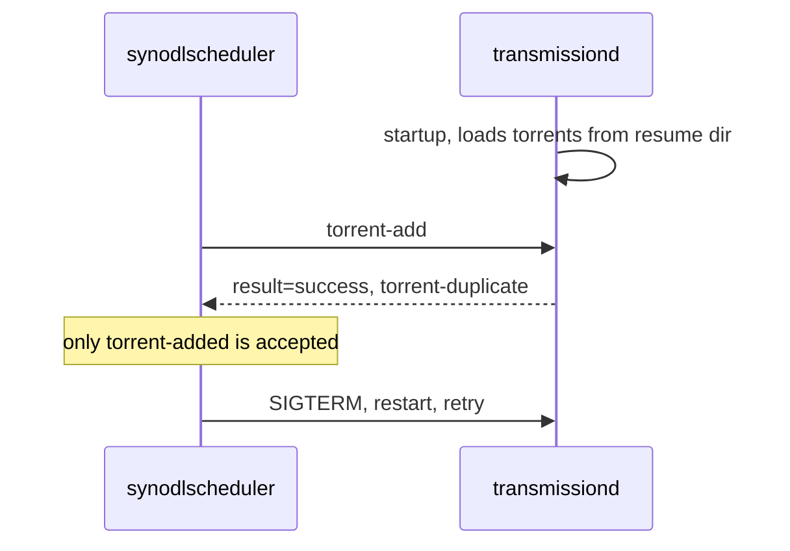

# synology-downloadstation-bt-fix

Restores BitTorrent downloads in Synology DownloadStation by replacing the bundled `transmissiond` with a newer Transmission that answers RPC, runs with the right socket group, and honors the private `task-id` argument DownloadStation depends on.

HTTP and FTP downloads are unaffected by the bug and keep working either way. Only BitTorrent is broken, and it is broken completely: no torrent can ever be added.

Three separate defects have to be fixed together. Each one alone still leaves BitTorrent dead, which is likely why this has gone unfixed for so long.

Two further defects decide whether the fix survives. Neither blocks the first torrent, so both stay invisible until the library grows. A duplicate add is reported as a failure, which puts DownloadStation into an endless restart loop, and the service unit's stop timeout is shorter than the time the daemon needs to save its state, which turns each of those restarts into a truncated resume file. Together they drop every task into an error the UI cannot explain and start re-downloading data that is already on disk.

## Symptoms

Every BitTorrent task fails the same way, regardless of the torrent, the tracker, or the destination folder.

- A torrent is added and immediately sits in an error state, or disappears.
- Tasks show bytes received but never complete a single piece, and no data file is written.
- Deleting a stuck task can hang the DownloadStation UI for two minutes.
- `/volume1/@appdata/DownloadStation/log/downloadstation.log` repeats this triplet:

```
transmission_rpc.cpp:220 SendTransmissionRPC error, status_code=0,
  error=Operation timed out after 120000 milliseconds with 0 bytes received
transmissiond.cpp:237 Failed to add torrent [/volume1/@download/<id>/<id>.torrent]
scheduler.cpp:1292 Failed to add torrent, task id: <id>
```

Reinstalling DownloadStation does not help. Resetting settings does not help. The network, the trackers, and the firewall are not involved.

The 120 second timeout in the first line is what identifies this bug. A log that shows `Failed to add torrent` without it, on a system where `verify.sh` already reports the patch as ACTIVE, is a different problem with its own recovery: see [Recovering from an add-fail loop](#recovering-from-an-add-fail-loop).

The fourth defect is a third signature again. It appears on a system where BitTorrent already worked, usually after a reboot or a package restart. Every task turns to error at once, torrents that are complete on disk report 0% when resumed, and the log fills with `Recv failure: Connection reset by peer` rather than either of the above. `transmissiond` is absent from `ps`, because DownloadStation stops it once no task is left in a runnable state. It shares the add-fail loop's consequence, a truncated resume bitfield, and explains why that truncation is possible at all.

## Root cause

DownloadStation does not implement BitTorrent itself. It bundles `transmission-daemon` and drives it over a Unix domain socket at `/tmp/synodl_transmission.sock`. The scheduler sends an RPC request to add the torrent and waits.

The bundled daemon accepts the connection and never replies. After 120 seconds DownloadStation gives up, kills the daemon, restarts it, and retries forever.



In `libtransmission/rpc-server.cc`, the whole request handler is wrapped in a guard:

```cpp
void handle_request(struct evhttp_request* req, void* arg)
{
    auto* server = static_cast<tr_rpc_server*>(arg);

    if (req != nullptr && req->evcon != nullptr)
    {
        ...
    }
}
```

When that condition is false the function returns without sending anything: the connection is accepted, the request is read, and no reply is ever written. Every other branch inside the handler sends a response, so this is the only path that can produce silence.

Transmission 4.1.0 removed the guard and replaced the peer lookup with `evhttp_connection_get_peer()`. That change is what this project ships.

### Why downgrading cannot work

Two facts, both verifiable against the upstream git history:

| Version | Unix-socket RPC | Guard present |
|---|---|---|
| 3.00 | not implemented | n/a |
| 4.0.0 through 4.0.6 | implemented | yes, `rpc-server.cc:427` in 4.0.0 |
| 4.1.0 and later | implemented | removed |

Transmission gained Unix-socket RPC in the 4.0 series. Anything older cannot bind `unix:/tmp/synodl_transmission.sock` at all, so it cannot serve DownloadStation regardless of the bug. And every 4.0.x release carries the guard. There is no older build to fall back to; the only direction that works is forward.

### The second defect: socket group ownership

Upstream Transmission only `chmod`s the RPC socket; it never sets the group. Synology's build ends up with `root:DownloadStation`, but a stock upstream build produces `root:root`. Combined with the configured `rpc-socket-mode` of `0770`, that makes the socket unopenable by the `DownloadStation` user that `synodlscheduler` runs as, which fails instantly with `status_code=0` and an empty error string.

Setting the setgid bit on the installed binary gives the daemon an effective group of `DownloadStation`, so the socket it creates inherits that group and matches stock exactly. The installer does this.

### The third defect: DownloadStation's private `task-id` extension

This one is why a stock upstream binary alone is not enough. A wire capture of the real exchange shows what DownloadStation actually does:

```json
{"method":"torrent-add","arguments":{"filename":"/volume1/@download/293/293.torrent","download-dir":"...","paused":false,"task-id":293}}
{"method":"torrent-get","arguments":{"ids":[293],"fields":["id","status","sizeWhenDone","name","isFinished"]}}
```

DownloadStation passes its own task number into `torrent-add` as a non-standard `task-id` argument, and then looks the torrent up **by that number**. Synology patched Transmission so the torrent's internal id becomes the supplied `task-id`. Stock Transmission ignores the unknown argument and assigns a sequential id, so the follow-up query asks for id 293, gets `{"torrents":[]}`, and DownloadStation reports `Failed to get torrent info`.

[patches/0001-honor-downloadstation-task-id.patch](patches/0001-honor-downloadstation-task-id.patch) restores that behaviour in 45 lines. `tr_torrents::add()` already stores torrents in a lookup table that tolerates gaps, so honoring an arbitrary id only requires growing the table and placing the torrent at the requested index, falling back to the sequential id when the slot is taken or no id was supplied.

### The fourth defect: the stop timeout is shorter than the state save

The three defects above are what stops BitTorrent working at all. This one is what stops it staying fixed, and it only appears once the library holds torrents large enough to matter.

`pkg-DownloadStation-transmissiond.service` sets no `TimeoutStopSec`, so it inherits the systemd default of 90 seconds. On shutdown Transmission writes a resume file per torrent. Those files scale with the piece count, so a multi-terabyte torrent produces a large one: on the reference system a 6.58 TB torrent has 392,361 pieces and a 50 MB resume file.

Measured on that system, a full save takes about 83 seconds. The margin against the 90 second default is roughly 7 seconds, and any run that is slower than average gets `SIGKILL` partway through the write.

That single kill is enough to start a loop that never exits on its own:



Re-verification is the expensive step. Hashing 2.8 TB of already-present data takes hours, and DownloadStation's RPC timeout is a fixed 120 seconds that no setting exposes. The daemon never survives long enough to finish, so each restart begins the same verification again and the tasks drain into the error state one by one.

Two details make this hard to recognise from the logs. The daemon is not crashing, so nothing reports a fault: the symptom is `SendTransmissionRPC error, status_code=0, error=Recv failure: Connection reset by peer`, which reads like a network problem. And after the save completes the process blocks in `futex_wait_queue_me` and never exits on its own, so the stop always ends in a kill regardless of the timeout.

This is also the missing half of the add-fail loop described in [Recovering from an add-fail loop](#recovering-from-an-add-fail-loop). That loop supplies the repeated kills; the short stop timeout is what makes each kill destructive. Raising the timeout does not stop the loop, but it stops a kill from truncating a resume file, so the loop no longer costs a re-download.

Because the state is durable once the save finishes, the fix is a bounded grace rather than an unbounded one. The installer writes a drop-in:

```ini
[Service]
TimeoutStopSec=300
KillSignal=SIGTERM
SendSIGKILL=yes
```

300 seconds is about 3.5x the observed save time, which covers a slow run without making a reboot wait indefinitely on a daemon that is known to hang after it has finished writing.

The drop-in goes to `/etc/systemd/system/pkg-DownloadStation-transmissiond.service.d/override.conf`. That path belongs to the administrator rather than to the package, so unlike the daemon binary it survives a DownloadStation update untouched, and it takes precedence over the unit shipped in `/usr/local/lib/systemd/system`. `verify.sh` reports whether it is present.

### The fifth defect: a duplicate add is reported as a failure

The daemon loads its own `torrents` directory at startup, so a torrent DownloadStation asks it to add after a restart is already present. Transmission answers with `torrent-duplicate` and `result: success`. DownloadStation accepts only `torrent-added`, so it treats a correct answer as a failure, stops the daemon, and retries forever. [Recovering from an add-fail loop](#recovering-from-an-add-fail-loop) covers the symptom and the manual recovery.

The two defects compound. This one supplies an endless stream of restarts; the stop timeout above decides whether each restart is harmless or destroys the saved state. Fixing only the timeout leaves the loop spinning; fixing only the loop leaves the next unrelated restart able to truncate a resume file. Both are needed.

The patch changes one branch. When a `torrent-add` carries a `task-id` and the existing torrent already has that exact id, the reply is `torrent-added` rather than `torrent-duplicate`:

```cpp
if (requested_id > tr_torrent_id_t{} && duplicate_of->id() == requested_id)
{
    data->args_out.try_emplace(
        TR_KEY_torrent_added,
        make_torrent_info(duplicate_of, TrFormat::Object, std::data(Fields), std::size(Fields)));
    tr_rpc_idle_done(data, Error::SUCCESS, {});
    return;
}
```

The condition is deliberately narrow. It requires a `task-id`, which no ordinary Transmission client sends, and it requires the already-loaded torrent to carry that same id, which happens only when this daemon assigned it from a previous `task-id` on the same task. A duplicate that is genuinely a different torrent, or one added by any other client, still gets the standard `torrent-duplicate` reply. The follow-up `torrent-get` that DownloadStation issues then succeeds, because the torrent really is present under the id it asked for.

The same patch closes a leak in the first one. `tr_torrents::add()` consumes the pending `task-id`, but a duplicate never reaches `add()`, so the id stayed set and the next `torrent-add` arriving without a `task-id` would silently inherit it. The pending id is now cleared once the add attempt returns, whatever the outcome.

### Why the newer daemon still talks to DownloadStation

Transmission 4.1 introduced a JSON-RPC 2.0 API, which raises the obvious question of whether an older client still works. It does. The release ships `libtransmission/api-compat.cc`, a compatibility layer mapping 212 legacy mixed-case RPC keys onto the current snake-case names. Older clients are a supported case upstream, not an accident, which is why DownloadStation needs no modification of its own.

### Why not patch DownloadStation instead

The RPC client lives in `libsynodl-transmission-rpc.so` and `libsynodldomainsocket.so`, both stripped closed-source binaries. Patching them would break on every package update and could not be published as reviewable source. Replacing the GPL daemon is the smaller, honest change.

## Compatibility

| Item | Value |
|---|---|
| Verified on | DS923+ (platform `r1000`), DSM 7.3.2-86009 Update 4, DownloadStation 4.1.2-5012 |
| Bundled daemon | transmission-daemon 4.0.5 (82ea3bbe46) |
| Replacement | transmission-daemon 4.1.1 plus the `task-id` patch |
| Result | Ubuntu 24.04.4 ISO at 7.5 MB/s, 200 peers, correct size and progress in the UI |
| Architectures | `x86_64`, `aarch64` |
| DSM runtime | glibc 2.36, libstdc++ 6.0.31, libcurl.so.4, libssl.so.3, libevent-2.1.so.6 |

The binary is built on Debian 12, which ships glibc 2.36 and GCC 12, matching DSM exactly. `libstdc++` and `libgcc` are linked statically so the C++ ABI cannot drift.

Distribution sonames do not line up with DSM, so the build links Transmission's bundled copies of libevent, libdeflate, libpsl, libb64, dht, libutp, libnatpmp and miniupnpc rather than the system ones. Debian 12 ships `libevent-2.1.so.7` while DSM has `libevent-2.1.so.6`; a binary linked against the system libraries fails at startup with `error while loading shared libraries`. After bundling, the only shared objects the daemon needs are ones DSM already provides:

| Library | Present on DSM |
|---|---|
| `libcurl.so.4` | yes |
| `libssl.so.3` | yes |
| `libcrypto.so.3` | yes |
| `libm.so.6`, `libc.so.6`, `ld-linux-x86-64.so.2` | yes |

Note that `/tmp` is mounted `noexec` on DSM, so a binary staged there cannot be executed. The installer stages into the package directory instead and validates it there, which sidesteps the problem; keep it in mind if you test a binary by hand.

[REFERENCE.md](REFERENCE.md) carries the full inventory: exact versions, every path touched, expected ownership and modes, SHA-256 checksums, and the DSM utilities the scripts depend on.

Other models are likely affected by the same bug, but only the hardware listed above has been tested. Check your own daemon before assuming:

```sh
/var/packages/DownloadStation/target/sbin/transmissiond --version
```

## Install

Download the artifact for your architecture from the releases page, or build it yourself with [build/build.sh](build/build.sh).

```sh
sudo ./scripts/install.sh ./dist/transmissiond-4.1.1-dsfix-x86_64
```

The installer writes the stop-timeout drop-in, stops DownloadStation, backs up the stock binary to `transmissiond.stock`, installs the replacement with the original owner and mode, restarts the package, and then proves the fix by sending a real RPC request over the domain socket. It refuses to install anything that is not an ELF binary identifying itself as `transmission-daemon`.

## Verify

```sh
sudo ./scripts/verify.sh
```

Reports the active daemon, both checksums, whether the patch is still applied, whether the stop-timeout drop-in is present, and the live RPC probe result. `RESPONSE HTTP/1.1 409 Conflict` is a pass: 409 is Transmission asking for a session id, which proves the handler ran and replied.

A missing drop-in is worth acting on even when everything else passes, because the daemon behaves normally until the next restart and only then loses its saved state.

To check the duplicate reply as well, point the second script at any torrent whose payload is small or absent:

```sh
sudo ./scripts/test-duplicate-add.sh /path/to/some.torrent
```

It adds paused, re-adds three ways, and removes with the data left alone. Case 3 is the one that matters: a re-add carrying the same `task-id` must answer `torrent-added`. On a daemon built without [patches/0002-report-added-for-downloadstation-duplicate.patch](patches/0002-report-added-for-downloadstation-duplicate.patch) it answers `torrent-duplicate`, which is the add-fail loop reproduced in one command. Cases 4 and 5 must keep answering `torrent-duplicate`; if they change, the condition has been widened past the request shape DownloadStation sends.

## Recovering from an add-fail loop

A second failure mode looks like the original bug from the outside. Tasks sit at "waiting" and then fail, and the daemon is restarted every twenty seconds or so. It is a different cause, and `verify.sh` reports the patch as ACTIVE throughout.

The log shows this pair repeating, with no RPC timeout anywhere near it:

```
synodlscheduler: transmission.cpp:37 Start Transmission daemon!
synodlscheduler: scheduler.cpp:1292 Failed to add torrent, task id: 551
```

Transmission loads torrents from its own `torrents` directory at startup, so by the time the scheduler asks it to add one, it is already loaded. Transmission answers:

```json
{"arguments":{"torrent-duplicate":{"id":2,"name":"..."}},"result":"success"}
```

Transmission calls that success. DownloadStation accepts only `torrent-added`, so it records a failure, stops the daemon, and retries forever.



The loop is not harmless. Each kill interrupts whatever the daemon was writing, and repeated cycles can truncate the resume bitfield. On a 1.7 TB torrent this was observed to drop reported progress from 99.98 percent to 10 percent and begin re-downloading 1.5 TB that was already on disk.

That truncation is not inevitable, and the fix for it is in [The fourth defect](#the-fourth-defect-the-stop-timeout-is-shorter-than-the-state-save). A kill only truncates because the stop timeout expires before the save finishes. With the drop-in installed the daemon still gets restarted by this loop, but it completes its write first, so progress survives and no re-download starts. Install that before working through the recovery below, or the recovery can be undone by the next cycle.

To recover, remove the torrent from the daemon while keeping the files, then let DownloadStation add it again. Run as root, because the socket is `root:DownloadStation` mode 0770:

```sh
S=/tmp/synodl_transmission.sock
SID=$(curl -s -D - -o /dev/null --unix-socket "$S" http://localhost/transmission/rpc \
      | tr -d '\r' | awk '/^X-Transmission-Session-Id:/{print $2; exit}')
rpc() { curl -s --unix-socket "$S" -H "X-Transmission-Session-Id: $SID" \
        -H 'Content-Type: application/json' --data "$1" \
        http://localhost/transmission/rpc; }

rpc '{"method":"torrent-get","arguments":{"fields":["id","name","percentDone"]}}'
rpc '{"method":"torrent-remove","arguments":{"ids":[1],"delete-local-data":false}}'

/usr/syno/bin/synowebapi --exec api=SYNO.DownloadStation2.Task \
  method=resume version=2 id='["dbid_551"]'
```

`delete-local-data` must be `false`. The point is to drop the daemon's registration, never the data.

The `exit` in that `awk` matters. The body of the 409 response repeats the session id inside a `<code>` element, so a match without `exit` returns both copies concatenated, and the 96 character result is rejected with `400 Bad Request` on every subsequent call.

The re-add succeeds because the duplicate is gone, and Transmission then checks the existing files rather than downloading them. The torrent comes back with its id set to the DownloadStation task id, which is the `task-id` extension doing its job. Wait for `status` to leave `checking` before judging the outcome; a 1.7 TB re-hash takes well over an hour, and a daemon killed mid-check reports whatever fraction it had reached.

The recovery above is manual and has to be repeated every time the loop starts. [patches/0002-report-added-for-downloadstation-duplicate.patch](patches/0002-report-added-for-downloadstation-duplicate.patch) removes the need for it, and is described in [The fifth defect](#the-fifth-defect-a-duplicate-add-is-reported-as-a-failure).

## Surviving DownloadStation updates

Updating the DownloadStation package overwrites `transmissiond` and silently reintroduces the bug. The installer keeps a copy of the patched binary, and [scripts/reapply.sh](scripts/reapply.sh) restores it when it detects a mismatch.

One command registers it as a boot-triggered task:

```sh
sudo ./scripts/install-boot-task.sh
```

That copies the scripts to `/var/packages/DownloadStation/etc/dsfix/scripts/`, which survives reboots, and registers a `bootup` task named `dsfix reapply transmissiond`. It is idempotent, backs up the scheduler database first, and the task shows up in **Control Panel** > **Task Scheduler** like any other.

DSM's own API rejects programmatic creation of root-owned event tasks, so the script writes to the scheduler database and calls `synoschedtask --sync`. If you would rather do it by hand, create a **Triggered Task** > **User-defined script**, owner `root`, event `Boot-up`, running:

```sh
/var/packages/DownloadStation/etc/dsfix/scripts/reapply.sh
```

`reapply.sh` is idempotent and exits immediately when the patch is already active, so running it often costs nothing.

When a package update replaces the daemon, `reapply.sh` promotes the newly installed vendor binary to be the stock backup before restoring the patched one, so `uninstall.sh` always returns you to the vendor binary you currently have rather than an outdated one.

One judgement call the script deliberately leaves to you: if Synology ever ships a DownloadStation release that fixes this properly, `reapply.sh` will keep replacing their fixed daemon with this one. After any DownloadStation update, run `verify.sh` and check the reported stock version. If the stock daemon answers RPC on its own, remove the task and run `uninstall.sh`; the fix has served its purpose.

## Uninstall

```sh
sudo ./scripts/uninstall.sh
```

Restores the stock daemon from the backup and removes the stop-timeout drop-in, returning the unit to the systemd default. BitTorrent will stop working again, which is the expected outcome of going back to the unpatched binary.

## Build from source

```sh
TARGET_ARCH=x86_64 BUILD_JOBS=4 ./build/build.sh
```

The build runs in a `debian:12` container and emits a stripped binary plus a `.sha256` file into `dist/`. Set `TARGET_ARCH=aarch64` for ARM models. On a machine with less than 4 GB of RAM available to Docker, keep `BUILD_JOBS=1`; the compiler is memory-hungry and gets OOM-killed otherwise, especially under QEMU emulation.

Building on a host of a different architecture requires `binfmt_misc` emulation. Docker Desktop and Colima provide it by default.

## Licence

The scripts, patches and documentation here are MIT licensed; see [LICENSE](LICENSE).

The distributed `transmission-daemon` binary is a modified Transmission and remains under the GPL. The corresponding source, the patch, and the exact build recipe are all published in this repository, as the GPL requires. Details and the full component inventory are in [THIRD-PARTY-LICENSES.md](THIRD-PARTY-LICENSES.md).

## Disclaimer

This replaces a vendor binary inside a package directory. It is reversible, and the stock binary is preserved, but it is not a supported configuration. Synology support will reasonably decline to help while it is applied. Run [scripts/uninstall.sh](scripts/uninstall.sh) before opening a support case.
